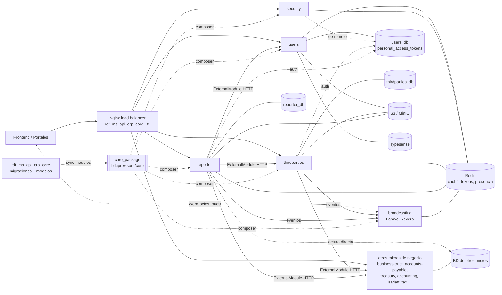

# Ecosistema de microservicios ERP Fiduprevisora (Linktic)

Documentación de los repositorios locales del proyecto **384 - CORE FIDUPREVISORA** (Azure DevOps, organización `Linktic`). Es un ERP de gestión fiduciaria construido como una suite de microservicios **PHP 8.2 / Laravel 11–12**. Cada servicio corre como un contenedor PHP-FPM detrás de un balanceador Nginx común y comparte infraestructura (PostgreSQL por servicio, Redis, S3/MinIO, Reverb) y el paquete Composer `fiduprevisora/core`.

Ruta local principal: `/Users/johnhernandez/Documents/Linktic/FiduPrevisora/`. Localmente solo están clonados 7 repositorios de los más de 30 que define el orquestador (`services.conf`).

## Servicios documentados

| Nombre | Propósito | Stack | Ruta local | Doc |
|---|---|---|---|---|
| rdt_ms_api_erp_core | Orquestador Docker/Nginx de todo el ERP y dueño del esquema (≈1.246 migraciones). Sin API propia | Laravel 11, PostgreSQL 15, Redis, MinIO, Typesense, OTel/Jaeger | `Linktic/FiduPrevisora/rdt_ms_api_erp_core` | [doc](rdt_ms_api_erp_core.md) |
| rdt_ms_api_erp_core_package | Paquete `fiduprevisora/core`: modelos compartidos, ExternalModule, middlewares, auditoría, caché, tokens de servicio | Paquete Laravel (illuminate 10/11, rama para 12), Pest | `Linktic/FiduPrevisora/rdt_ms_api_erp_core_package` | [doc](rdt_ms_api_erp_core_package.md) |
| rdt_ms_api_erp_users | Identidad y autenticación, dueño de `users_db` y de los tokens Sanctum centralizados; roles, permisos, 2FA, perfil, reportes y búsqueda | Laravel 12, Sanctum, Scout + Typesense, S3, SQS | `Linktic/FiduPrevisora/rdt_ms_api_erp_users` | [doc](rdt_ms_api_erp_users.md) |
| rdt_ms_api_erp_security | Login (local/LDAP/Azure AD), ciclo de vida de tokens, dashboards de seguridad; lector remoto de `users_db` | Laravel 12, Sanctum, Pest, OTel | `Linktic/FiduPrevisora/rdt_ms_api_erp_security` | [doc](rdt_ms_api_erp_security.md) |
| rdt_ms_api_erp_thirdparties | Terceros (naturales y jurídicos), KYC, importación masiva, validación SARLAFT/RUES/Inspektor; dueño de `thirdparties_db` | Laravel 11, Reverb, S3, colas, OTel | `Linktic/FiduPrevisora/rdt_ms_api_erp_thirdparties` | [doc](rdt_ms_api_erp_thirdparties.md) |
| rdt_ms_api_erp_reporter | Generación asíncrona de reportes Excel leyendo las BD de otros micros, con salida en S3 y aviso por WebSocket | Laravel 11, Reverb, S3, colas, PhpSpreadsheet | `Linktic/FiduPrevisora/rdt_ms_api_erp_reporter` | [doc](rdt_ms_api_erp_reporter.md) |
| rdt_ms_api_erp_broadcasting | Servidor WebSocket (Laravel Reverb) para notificaciones en tiempo real | Laravel 11, Reverb, Redis | `Linktic/FiduPrevisora/rdt_ms_api_erp_broadcasting` | [doc](rdt_ms_api_erp_broadcasting.md) |

### Copias y variantes

| Nombre | Qué es | Ruta local | Doc |
|---|---|---|---|
| Test/rdt_ms_api_erp_core | Copia del core al mismo commit (`develop` 4a5cf3da), clonada por HTTPS y sin vendor ni nginx generado | `Linktic/Test/rdt_ms_api_erp_core` | [doc](test-rdt_ms_api_erp_core.md) |
| Test/rdt_ms_api_erp_reporter | Copia del reporter al mismo commit (`chore/report-library` 4c27ab8), clonada por HTTPS y sin vendor | `Linktic/Test/rdt_ms_api_erp_reporter` | [doc](test-rdt_ms_api_erp_reporter.md) |
| testfidu/rdt_ms_api_erp_core | Clon SSH de prueba con checkout de `master`, congelada en 2025-02-20 (core base temprano) | `Linktic/testfidu/rdt_ms_api_erp_core` | [doc](testfidu-rdt_ms_api_erp_core.md) |

## Cómo se relacionan

- **Entrada**: todo el tráfico HTTP entra por el Nginx del orquestador (`localhost:82` en local, ALB + ECS en AWS) y se enruta por prefijo: `/<servicio>/api/<servicio>` → `rdt-<servicio>:9000`.
- **Autenticación**: `users` es dueño de `personal_access_tokens`. Los demás micros validan los tokens Sanctum leyendo `users_db` de forma remota (conexión `micro_users_pgsql`) y usan la caché Redis de tokens del core. `security` gestiona el login y los dashboards sobre esa misma BD.
- **Servicio a servicio**: se usa HTTP mediante `ExternalModule` del paquete core, con un token interno (`SERVICES_INTERNAL_TOKEN`) y propagación del usuario original.
- **Tiempo real**: thirdparties y reporter emiten eventos hacia **Reverb** (`broadcasting`).
- **Datos**: cada micro tiene su PostgreSQL. `reporter` lee directamente las BD de varios micros de negocio. El core es dueño de las migraciones globales y las sincroniza; el paquete core recibe los modelos (`sync-models.sh`) y su pipeline los propaga a los micros.



## Arranque local (resumen)

```bash
cd /Users/johnhernandez/Documents/Linktic/FiduPrevisora/rdt_ms_api_erp_core
./scripts/clone_microservices.sh        # opcional: clona los repos hermanos (SSH)
./generate_nginx_config.v2.sh
./startup.v2.sh                         # obligatorios: core, users, security, thirdparties, broadcasting
# http://localhost:82/<servicio>/api/<servicio>/...
docker exec -it fidu-<servicio> php artisan test
```

Se necesita la variable `AZURE_TOKEN` para que Composer descargue `fiduprevisora/core` desde Azure DevOps. Para clonar por SSH, la guía es `Linktic/testfidu/GUIA-CLONE-SSH-AZURE.md`.

## Convenciones comunes

- Respuestas con el formato `{ success, data, message }`, controladores delgados, validación con `FormRequest`, listados con `spatie/laravel-query-builder`, enums con valores en español.
- Permisos jerárquicos `module-<dominio>-<feature>[-list|-show|-create|-edit|-delete|-export|-action_*]` (Spatie).
- Conventional Commits, validados por el hook `.githooks/commit-msg`.
- CI en Azure Pipelines (develop/qa/uat): pruebas, Grype, Bearer y Sonar según el repo. Despliegue en AWS ECS con CloudFormation (`infra/`).
- Los `README.md` de varios repos son plantillas (de Azure DevOps o "Proyecto BASE"). La documentación real está en `AGENTS.md`, `CLAUDE.md`, `ARCHITECTURE.md`, `openspec/` y `docs/`.

## Seguridad de esta documentación

Solo se incluyen **nombres** de variables de entorno. No se copiaron valores de `.env`, contraseñas, tokens ni cadenas de conexión.

*Generado el 2026-10-19 a partir del estado local de los repositorios (los últimos commits son de agosto de 2026).*
